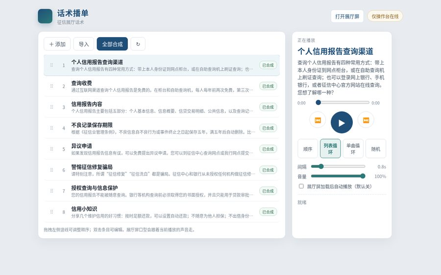
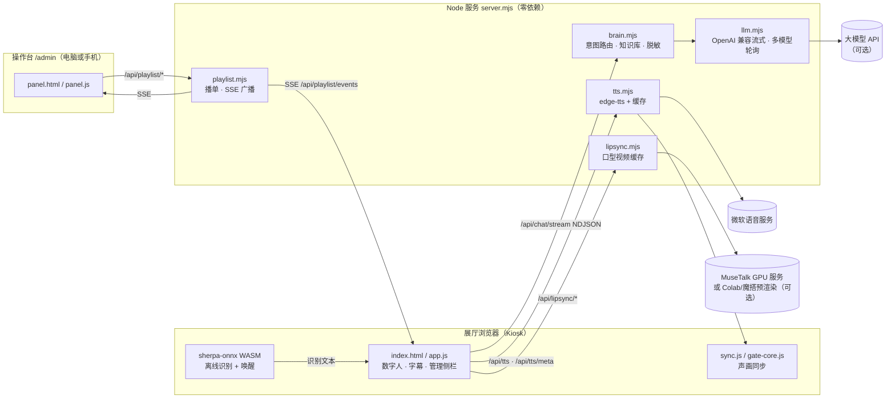

<div align="center">

# 征信服务数字人 · zhengxin-dh

**面向银行网点征信服务区的展厅数字人：真人形象、语音对话、离线可用、话术播单可遥控。**

*A realistic digital-human kiosk for credit-report service halls — offline speech recognition, streaming LLM answers with a curated knowledge base, neural TTS with word-level lip/subtitle sync, and a remote-controlled script playlist.*


 &nbsp; 

</div>

---

## 目录

- [功能特性](#功能特性)
- [架构](#架构)
- [快速开始](#快速开始)
- [配置](#配置)
- [语音合成与音色](#语音合成与音色)
- [口型模式](#口型模式)
- [话术播单与管理端](#话术播单与管理端)
- [全屏与布局切换](#全屏与布局切换)
- [部署](#部署)
- [GPU 口型预渲染（可选）](#gpu-口型预渲染可选)
- [项目结构](#项目结构)
- [测试](#测试)
- [常见问题](#常见问题)
- [路线图](#路线图)
- [参与贡献](#参与贡献)
- [许可证](#许可证)

## 功能特性

- 🧍 **写实全身数字人**：1080×1920 竖屏设计，横屏/普通窗口自动等比缩放；25 套服装可轻触或语音切换（“换一套”“换成旗袍”）。
- 🎙️ **离线语音识别**：sherpa-onnx WebAssembly 在浏览器本机识别，录音不出本机；支持“你好 / 小信”语音唤醒。
- 💬 **知识库优先的问答**：内置征信知识库与意图路由，**断网可用**；可选接入一个或多个 OpenAI 兼容大模型（流式逐句播报；多个模型轮流使用，超时、限流或服务异常时换下一个，全部失败再回落知识库）。
- 🔊 **神经网络语音**：edge-tts 女声（晓晓 / 晓伊），逐词时间戳驱动字幕与口型；常用话术预合成缓存，断网也能播。
- 👄 **声画同步**：按“此刻听到的声音”驱动嘴型，句首句尾静音不动嘴；可选门控说话循环、MuseTalk 预渲染口型视频。
- 📋 **话术播单**：像音乐播放器一样管理固定话术（顺序/列表循环/单曲循环/随机、拖拽排序、批量合成），电脑或手机遥控展厅屏。
- 🖥️ **VS Code 风格管理端**：右上角悬停按钮展开左侧管理栏，人物贴右；横屏下按真实视口分栏，场景整幅铺满。
- ⛶ **一键全屏**：右上角悬停出现全屏/退出全屏按钮，或按 `F`。
- 🔒 **隐私保护**：示例数据全部打码，答复中出现的身份证号、手机号、银行卡号自动脱敏；不主动说话，没提问不播报。

<p align="center"></p>

## 架构



## 快速开始

**环境要求**：Node.js ≥ 20、Python 3、`pip install edge-tts`、Chrome / Edge 浏览器。

```bash
git clone https://github.com/IVMYM/zhengxin-dh.git
cd zhengxin-dh
npm install                 # 只装开发用的 playwright-core，运行本身零依赖
pip install edge-tts
bash scripts/fetch-asr.sh   # 下载离线识别模型（约 200MB，放到 public/asr/，不入库）
cp .env.example .env        # 可选：填写大模型接口
npm start                   # 或 npm run dev（修改服务端代码自动重启）
```

浏览器打开 <http://localhost:43200>。

> 麦克风只能在 `localhost` 或 HTTPS 页面使用。展厅一体机请在本机运行服务并用 `localhost` 访问。

## 配置

| 位置 | 说明 |
|---|---|
| `.env`（从 `.env.example` 复制，**不入库**） | 大模型地址/密钥/模型名，或多模型轮询列表 `LLM_MODELS`、默认音色、端口等，环境变量优先 |
| `config/site.json` | 展厅名称、副标题、行名 `bank`、热线、`showText`（是否显示文字）、`mouthMode`（`loop`/`gate`）、`attractAfterSec` |
| `config/outfits.json` | 服装清单（`id`、名称、待机/说话视频、关键词、口型头像 id、`sensitive`） |
| `lib/kb.mjs` | 知识库：关键词、口播文本、要点卡片、推荐问题、自助查询流程 |

大模型示例（占位符）。只填这三项时，行为与原来完全一致：

```bash
LLM_BASE_URL=https://your-llm-host.example.com/v1
LLM_API_KEY=your-api-key-here
LLM_MODEL=your-model-name
```

多个模型轮流使用时，在 `.env` 增加下面两行（一行 JSON；密钥只写在环境变量里，用 `apiKeyEnv` 引用）。设置了 `LLM_MODELS` 后以列表为准。每次请求从健康目标里轮流选一个；某个目标返回 HTTP 429/5xx、连不上，或 `LLM_FIRST_MS` 内没有首字，就把它冷却一小会儿（响应头有 `Retry-After` 则照做，否则约 60 秒）并立刻换下一个，全部失败才回落知识库。日志只打模型名和主机，不打密钥。IFM/K2 的多轮 `reasoning_content` 只加在该接口上。

AMD Token Factory 的免费模型**只用于开发/测试**：`https://developer.amd.com.cn/radeon/api/v1`（OpenAI 兼容，支持工具和流式），同一账号大约 20 次/分钟，模型有时会返回 429 `model_concurrency_rate_limit_exceeded`。

```bash
AMD_API_KEY=your-amd-api-key
LLM_MODELS=[{"baseUrl":"https://api.ifm.ai/v1","apiKeyEnv":"LLM_API_KEY","model":"IFM/K2-Horizon-375B-A23B","extra":{"reasoning_effort":"low"}},{"baseUrl":"https://developer.amd.com.cn/radeon/api/v1","apiKeyEnv":"AMD_API_KEY","model":"DeepSeek-V4-Flash","extra":{}},{"baseUrl":"https://developer.amd.com.cn/radeon/api/v1","apiKeyEnv":"AMD_API_KEY","model":"DeepSeek-V4.1-Flash","extra":{}},{"baseUrl":"https://developer.amd.com.cn/radeon/api/v1","apiKeyEnv":"AMD_API_KEY","model":"MiMo-V2.6-Flash","extra":{}},{"baseUrl":"https://developer.amd.com.cn/radeon/api/v1","apiKeyEnv":"AMD_API_KEY","model":"Qwen3.8-Flash-Next","extra":{}},{"baseUrl":"https://developer.amd.com.cn/radeon/api/v1","apiKeyEnv":"AMD_API_KEY","model":"GLM-5.3-Flash","extra":{}}]
```

策略是**知识库优先**：知识库有把握的问题按审定口径回答，保证合规；开放问题才交给大模型，并附上相关知识条目作参考。首句到达前会先说“好的，我想一想”，模型思考内容不朗读。`/api/health` 可查看是否已接入大模型（轮询时 `llm` 为逗号分隔的模型名）。

常用 URL 参数：`?kiosk=1` 隐藏鼠标、`?voice=female2` 晓伊、`?text=1|0` 显示/隐藏文字、`?mouth=gate` 门控口型、`?outfit=<id>` 指定服装、`?wake=0` 关闭唤醒、`?asr=webspeech|off` 切换识别。

## 语音合成与音色

- 服务端调用 edge-tts 流式合成，同时保存逐词时间戳（`cache/tts/<hash>.mp3|.json`），字幕和口型据此对齐。
- 只提供**女声**（与女性形象一致）：`female` 晓晓（默认）、`female2` 晓伊。旧数据中的男声会自动迁移为晓晓。
- 修改话术后执行 `npm run prewarm` 预合成（`--force` 全部重做、`--prune` 清理旧文件）。仓库附带知识库话术的预合成音频，**断网也能播报**。
- 实时合成失败时依次回退：其他音色的缓存 → 浏览器自带中文语音 → 仅字幕。

## 口型模式

| 模式 | 设置 | 效果 | 资源 |
|---|---|---|---|
| 说话循环（默认） | `"mouthMode": "loop"` | 出声时播说话视频，句首句尾停在闭嘴帧 | CPU |
| 门控说话循环 | `"mouthMode": "gate"` / `?mouth=gate` | 句中停顿也停在真实闭嘴帧，按时间戳规划路线 | CPU |
| MuseTalk 口型视频 | `LIPSYNC_URL` 或预渲染缓存 | 真实对口型；固定话术优先播放预渲染视频 | GPU（可离线预渲染） |

闭嘴帧标注：`npm run gate:build`（Python + OpenCV）。声画偏差测量：`npm run check:av`。

## 话术播单与管理端

当现场识别不稳或时延偏高时，可以改用预先写好的话术：

1. 打开操作台 `http://<主机>:43200/admin`，或在展厅页右上角悬停点击「展开管理端」（也可 `Ctrl/⌘+B`、`Alt+P`）。
2. 添加/导入（支持 `标题|正文` 每行一条，或 .txt/.csv）→「全部合成」。
3. 播放、暂停、上一首/下一首、四种播放模式、拖拽排序、间隔与音量；展厅屏通过 SSE 实时同步。
4. 默认**不自动播放**；可在操作台勾选“展厅屏加载后自动播放”。

运行时数据保存在 `data/playlist.json`（不入库，首次启动自动生成种子话术）。

## 全屏与布局切换

鼠标移到右上角会出现两个按钮：

- **全屏 / 退出全屏**：也可按 `F`，`Esc` 退出；不支持或被浏览器拒绝时会有简短提示。
- **展开 / 收回管理端**：竖屏时左侧固定栏、人物贴右；横屏时管理栏 420–520px 不缩放，右侧场景整幅铺满。

现场设置：长按左上角 2 秒或按 `F2`（音色、唤醒、识别引擎、服装）。

## 部署

### 本机 / 展厅一体机（Node）

```bash
npm start
# Windows：scripts\kiosk.bat   macOS：bash scripts/kiosk-mac.sh   Linux：bash scripts/kiosk.sh
```

kiosk 脚本以独立配置目录启动全屏 Chrome，并允许自动播放与麦克风，开机后无需点击即可唤醒。建议把服务与 kiosk 脚本都设为开机自启；显示器建议竖屏 1080×1920。

### Cloudflare（规划中）

计划提供 Workers + 静态资源 + R2 + Durable Objects 版本：大模型密钥作为 Worker Secret 不下发浏览器，管理接口加密码保护，公共接口限流。进度见 [路线图](#路线图)。

## GPU 口型预渲染（可选）

- `gpu-lipsync/`：MuseTalk 1.5（fp16）FastAPI 服务，端口 8787。Windows GPU 机运行 `install.bat` / `setup-all.bat`（需先 `set MODEL_MIRROR=<你的模型镜像>`）。
- 无 GPU 时可用免费算力离线预渲染固定话术：
  - Google Colab：见 [`gpu-lipsync/colab/README.md`](gpu-lipsync/colab/README.md)
  - 魔搭 ModelScope Notebook：见 [`gpu-lipsync/modelscope/README.md`](gpu-lipsync/modelscope/README.md)
- 预渲染结果解压到 `cache/lipsync/` 后重启服务即可使用；服务不可用时自动退回循环视频。
- 模型权重与打包产物（`ms-bundle.tar`、`*.pth` 等）**不入库**，由脚本从官方来源下载并校验 sha256。

## 项目结构

```
├── server.mjs              # Node 服务：静态文件、问答、TTS、口型、播单、SSE
├── lib/
│   ├── kb.mjs              # 征信知识库与话术
│   ├── router.mjs          # 意图路由（含离线识别同音误字纠正）
│   ├── brain.mjs           # 问答主流程、敏感信息脱敏
│   ├── llm.mjs             # OpenAI 兼容流式大模型、多模型轮询、句子切分
│   ├── tts.mjs             # edge-tts 合成、缓存、音色
│   ├── playlist.mjs        # 话术播单存储、播放顺序、批量合成、SSE
│   ├── lipsync.mjs         # MuseTalk 口型视频缓存与调用
│   └── outfits.mjs         # 服装清单
├── public/                 # 前端（原生 JS，无需构建）
│   ├── index.html · app.js · app.css      # 展厅页
│   ├── panel.html · panel.js · panel.css  # 话术操作台 /admin
│   ├── sync.js · gate-core.js · lipsync.js
│   ├── asr/                # sherpa-onnx WASM（模型文件需下载）
│   └── media/              # 数字人视频素材（AI 生成）
├── config/                 # site.json、outfits.json
├── cache/tts/              # 预合成语音与逐词时间戳
├── gpu-lipsync/            # MuseTalk 服务、Colab/魔搭预渲染脚本
├── scripts/                # 预合成、截图与检查、kiosk 启动脚本
├── tests/                  # node --test 单元测试
└── docs/images/            # README 截图
```

## 测试

```bash
npm test                    # 路由、问答、大模型回落、脱敏、播单、音色、界面约定
npm run check:layout        # 无头截图：管理端展开/收回（竖屏 + 多种横屏分辨率）
npm run check:fullscreen    # 无头检查：全屏按钮（模拟 Fullscreen API）
npm run check:mic           # 麦克风按钮与提示
npm run check:av            # 声画同步测量
```

无头检查需要本机 Chrome（`CHROME=/path/to/chrome`），会在 `out/` 生成截图。

## 常见问题

<details><summary>页面不出声 / 只有字幕？</summary>

确认 `python3 -c "import edge_tts"` 可用（Mac 上 Homebrew 与系统 Python 可能不同，可用 `PYTHON=` 指定）；首次播放需要用户点一下页面，kiosk 脚本已带自动播放参数。
</details>

<details><summary>麦克风无法使用？</summary>

必须用 `localhost` 或 HTTPS 打开；macOS 还需在“系统设置 → 隐私与安全性 → 麦克风”中允许浏览器。
</details>

<details><summary>不接大模型可以用吗？</summary>

可以。不填 `.env` 时完全使用本地知识库作答，断网可用。
</details>

<details><summary>大模型回答的口径安全吗？</summary>

知识库有把握的问题始终使用审定口径；系统提示词禁止编造费用、时限等数字，并对号码自动脱敏。上线前仍建议业务人员审核开放问答。
</details>

<details><summary>识别模型为什么不在仓库里？</summary>

模型约 200MB，超过 GitHub 单文件限制，请运行 `bash scripts/fetch-asr.sh` 从 sherpa-onnx 官方 Release 下载。
</details>

## 路线图

- [x] 离线识别、语音唤醒、知识库问答、流式大模型
- [x] edge-tts 逐词时间戳、声画同步、门控口型
- [x] 25 套服装、话术播单、VS Code 风格管理端、全屏按钮
- [ ] MuseTalk 全量话术预渲染
- [ ] Cloudflare 部署版（Workers + R2 + Durable Objects，管理端鉴权、限流）
- [ ] 叫号 / 呼叫系统联动

## 参与贡献

欢迎 Issue 与 PR，请先阅读 [CONTRIBUTING.md](CONTRIBUTING.md)。请勿提交任何密钥或真实个人信息。

## 许可证

本项目代码以 [MIT](LICENSE) 许可发布（许可证类型待维护者最终确认）。

第三方组件遵循各自许可：[sherpa-onnx](https://github.com/k2-fsa/sherpa-onnx)（Apache-2.0）、[MuseTalk](https://github.com/TMElyralab/MuseTalk)（MIT，见 `gpu-lipsync/LICENSE`；模型权重另有条款，需自行下载）、[edge-tts](https://github.com/rany2/edge-tts)（LGPL-3.0，作为外部命令调用）。数字人形象与服装视频为 AI 生成素材；服装设计参考自公开图库，参考原图不随仓库分发。

> 本项目为演示用途，与任何金融机构无隶属关系；征信相关口径以中国人民银行征信中心及各网点公示为准。
